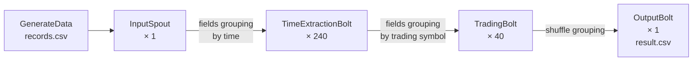

# Real-Time Stock Exchange Analysis with Apache Storm

A stream processing pipeline built with **Apache Storm** that processes a full trading day of simulated stock exchange orders and computes the matched trading volume for each trading symbol.

**Stack:** Java 8, Apache Storm 2.1, Maven, OpenCSV

## Overview

The pipeline simulates the Tehran Stock Exchange trading session (8:30 to 12:30, 240 minutes) and processes **2.4 million buy and sell orders** through a parallel Storm topology.

- **40 trading symbols**, each priced at `symbol ID × 100` Rial with up to ±1% fluctuation (for example, symbol 37 trades between 3,663 and 3,737 Rial)
- **10,000 exchange codes** (traders), each placing one buy or sell order per minute
- **1 to 100 shares** per order

## Architecture



| Component | Parallelism | Role |
|---|---|---|
| `GenerateData` | | Generates 2.4M random orders and writes them to `records.csv` |
| `InputSpout` | 1 | Reads orders and emits them into the topology |
| `TimeExtractionBolt` | 240 | Partitioned by minute (one task per trading minute); strips the timestamp and forwards the order |
| `TradingBolt` | 40 | Partitioned by trading symbol (one task per symbol); keeps buy and sell volume per price and matches orders at the same price |
| `OutputBolt` | 1 | Collects the matched volume per symbol and writes `result.csv` |

**Fields grouping** sends all orders for the same trading symbol to the same `TradingBolt` task, so each task can keep its own order state in memory without coordination.

## Data Format

**Input** (`records.csv`): one order per line

```
Time, Exchange Code, Order Type (0 or 1 for sell or buy), Trading Symbol, Price, Shares
08:30:00, 1, 1, 22, 2178, 64
```

Exchange code 1 placed an order at 08:30:00 for 64 shares of symbol 22 at 2,178 Rial.

**Output** (`result.csv`): matched volume per trading symbol

```
Trading Symbol, Matched Shares
1, 64460
2, 56365
...
```

## Getting Started

### Prerequisites

- Java 8 or later
- Maven

### Run

```bash
mvn compile exec:java -Dexec.mainClass=Main
```

This generates `records.csv`, runs the topology on a local Storm cluster, and writes the results to `result.csv`.

## Project Structure

```
src/main/java/
├── Main.java                    # Builds and submits the topology
├── GenerateData.java            # Generates simulated exchange orders
├── InputSpout.java              # Spout that emits orders
├── Record.java                  # Order model
└── storm/Bolts/
    ├── TimeExtractionBolt.java
    ├── TradingBolt.java
    └── OutputBolt.java
```
